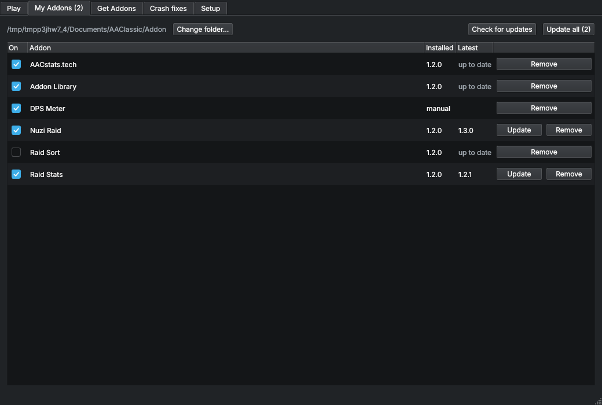

# ArcheAge Classic Linux Launcher

A free app that gets ArcheAge Classic running on Linux and keeps your addons up to date. The official launcher still handles login and patching; this one handles the tweaks and hurdles around it. It checks your system for the drivers the game needs and tells you the exact command to fix what's missing on your distro, finds or downloads the official launcher, starts the game through it, and installs and updates addons. See the [roadmap](ROADMAP.md) for what's next.

**Safe to use:** the launcher never changes game files, never touches the running game or anti-cheat, and never sees your login. It installs addons only through the game's own addon folder and `addons.txt`, and starts the official launcher, which does login and patching itself. See the ground rule in the [roadmap](ROADMAP.md).

## Desktop app



Download `ArcheAge-Classic-Linux-Launcher-x86_64.AppImage` from the [Releases page](https://github.com/Z-arium/AAC-ADDON_MANAGER/releases), then:

```bash
chmod +x ArcheAge-Classic-Linux-Launcher-x86_64.AppImage
./ArcheAge-Classic-Linux-Launcher-x86_64.AppImage
```

The first time it opens, **Setup** walks you through three things:

1. **Your system**: FUSE 2, Vulkan, a Vulkan driver, and the 32-bit Vulkan and OpenGL libraries the 32-bit game needs, with copyable fix commands for Arch/CachyOS, SteamOS, Debian/Ubuntu/Mint, Fedora and openSUSE.
2. **The official launcher**: found where it usually lives, or downloaded from aa-classic.com.
3. **Your addon folder**: found automatically once the game has run, or chosen by you.

The window looks like a window from ArcheAge itself: parchment pages under bronze-edged tabs, set in the bundled Alegreya fonts. It opens on **Play**: a plaque says whether you're ready, shows the four steps Play takes and holds the Play button, with your addons (switch them on or off right there), the checks from Setup and your recent sessions below. Tabs hold My Addons, Get Addons, Crash fixes and Setup.

- **Play** updates your addons, then starts the official launcher, where you log in and press Play. While the game runs a meter in the status bar shows how much of its 4 GB the game uses against the point where sessions crashed (`aacam watch` shows it in a terminal), and the app shows a desktop notification when the 32-bit game gets close to its 4 GB limit, before it crashes. When it closes, the app checks the logs and the kernel for signs of a crash (out of memory, unhandled exceptions, GPU errors, a very short session). If it finds one, it explains it, saves the logs to a crash report zip, and suggests the fix that matches.
- **Wine build**: the official launcher runs the game with Wine or Proton. Under Proton the game's anti-cheat closes it right after server select, so when the official launcher's Wine-Staging prefix exists, Play points it at a Wine-Staging build from Heroic or Lutris (`AAC_WINE`, `AAC_WINEPREFIX`). You can pick another build or let the official launcher choose. A WoW64 build would leave the game more of its 4 GB. Until the ArcheAge Classic team confirms it is allowed it is off by default, but you can test it on your own PC at your own risk (`aacam wine --test-wow64`, or the checkbox in Crash fixes). That downloads it, copies your Wine prefix so the original stays untouched, and `aacam wine --stop-wow64` goes back.
- **Crash fixes** are switches applied the next time the game starts, using only variables the official launcher itself knows: run the game on the NVIDIA card on machines with two graphics chips, turn off esync/fsync under Proton, or draw with WineD3D instead of DXVK. A DXVK setting that leaves the game more of its 4 GB is built but stays off until the ArcheAge Classic team confirms it is allowed (see the ground rule in [ROADMAP.md](ROADMAP.md)). Until then, lowering texture quality in the game's options is the fix for out-of-memory crashes. **Diagnostics** records extra Wine, Proton and DXVK logs for one session, for bug reports. All of these are environment variables passed to the official launcher, which passes them to the game. No game files are touched and nothing reads or changes the game's memory, so there is nothing for anti-cheat to object to. Crash reports hide the login token the official launcher writes to its logs, and leave the game's crash dumps out because they can contain it.
- **My Addons**: everything in your addon folder, a checkbox to turn each one on or off in game, its version and release date, and Update, Details and Remove buttons. Filter by enabled, disabled or has an update, and sort by name, updates first or release date. The tab shows how many updates are waiting.
- **Details** (or double-click an addon): its description, author, tags, dependencies, repo, and release notes. **Update…** shows what's new since your version first; **Roll back** returns to the version before the last update, keeping its settings.
- **Backups…**: every addon's settings and `addons.txt` in one zip. One is made automatically before each update; restore any of them, and what you had is saved first. Addons you installed by hand or with another manager that are in the catalogue get a **Track** button, so they update like the rest without losing their settings.
- **Get Addons**: the public catalogue, with search and tag filters, each addon's last release date and downloads (**Get release dates** looks them up), sorting by name, date or downloads, and details on double-click. Install pulls in any addons it depends on.
- **Update all** checks every addon you installed on startup and updates them in one click, after showing what's new. Setup has options to update automatically when the launcher starts and when you press Play.
- The app tells you in the status bar when a newer version of itself is out.
- **When something goes wrong** the message says what to do: GitHub's hourly limit (with the time it resets and a button to add a token), no internet, a broken or wrong zip, a renamed addon repo. An addon whose repo is gone doesn't stop the others from updating.
- **GitHub token** (Setup, optional): raises GitHub's limit from 60 lookups an hour to 5,000 for players with many addons. Update checks are cached and revalidated with ETags, so checking again costs almost nothing.
- **Copy diagnostics** (Setup) copies your system details, the launcher's own log (`~/.local/state/aacam/aacam.log`, tokens hidden) and the official launcher's log for a bug report; **Report a bug** opens the issue form.

Running from source instead: `./install.sh` installs both the app (menu entry "ArcheAge Classic Linux Launcher") and the `aacam` command.

## Command line

`aacam` does the same from a terminal. It reads the same public addon catalogue as Classic Addon Manager ([classic-addon-manager/addons](https://github.com/classic-addon-manager/addons)) and downloads addons straight from their GitHub releases.

### Install

```bash
git clone https://github.com/Z-arium/AAC-ADDON_MANAGER
cd AAC-ADDON_MANAGER
./install.sh
```

`install.sh` needs only Python 3. It puts aacam in its own virtualenv under `~/.local/share/aacam/venv` and links it to `~/.local/bin/aacam`; run it again after `git pull` to upgrade. If you prefer pipx: `pipx install .`

### Use

```bash
aacam detect                  # find AAClassic inside your Wine/Proton/Lutris prefixes
aacam path ~/Documents/AAClassic   # or set it yourself
aacam search raid             # browse the catalogue
aacam info nuzi-raid
aacam install nuzi-raid       # installs dependencies too, and enables it
aacam list                    # installed addons, enabled or not, and versions
aacam update                  # update everything aacam installed (--check to only look)
aacam disable nuzi-raid       # keeps the files, removes it from addons.txt
aacam remove nuzi-raid        # keeps saved settings; --purge deletes them
aacam install --repo Z-arium/aac-dps-meter   # straight from a GitHub repo; updates like the rest
aacam import ~/Downloads/MyAddon.zip   # an addon that isn't in the catalogue

aacam doctor                  # check drivers and libraries, print the fix commands for your distro (--network: HTTPS to GitHub too)
aacam launcher --download     # download the official launcher (or --set /path/to/it.AppImage)
aacam launch --update-first   # update addons, then start the official launcher
aacam report                  # system details and the launchers' logs, to paste when asking for help
aacam changes nuzi-raid       # release notes: what's new since your version
aacam rollback nuzi-raid      # back to the version before the last update, settings kept
aacam backup                  # back up addon settings and addons.txt (--list, --restore N)
aacam options update-on-start=on   # update-on-start, update-before-play
aacam track --all             # start updating addons you installed by hand or with another manager
aacam token --set TOKEN       # save a GitHub token (60 -> 5,000 lookups an hour); `aacam token` shows what's left
aacam fixes                   # list crash fixes; --on nvidia_gpu, --off wined3d, --diagnostics on
aacam wine                    # show or choose the Wine build (--set DIR, --auto, --launcher, --test-wow64, --stop-wow64)
aacam crash-report            # after a crash: collect logs and kernel messages into a zip and name known causes
aacam crash-report --history  # recent sessions: how long they lasted, crash cause, zone
aacam launch --set 'lutris lutris:rungame/archeage-classic'   # start the game your own way instead
```

Commands that change files refuse to run while ArcheAge is open, because the game can overwrite `addons.txt` on exit. Pass `--force` to override.

## How it works

- Addons live in `Documents/AAClassic/Addon/<name>/`, each with a `main.lua`. The game loads the folders listed in `Documents/AAClassic/Addon/addons.txt`, one per line. Wine usually maps the Windows Documents folder to `~/Documents`, so with the official launcher that is `~/Documents/AAClassic/Addon`.
- Detection checks `~/Documents/AAClassic` (and your XDG Documents folder), then each Wine user's Documents and `drive_c/AAClassic*/Documents/Addon` in `~/.wine`, `$WINEPREFIX`, the official launcher's `~/.local/share/AAClassic/*` prefixes, `~/Games/*` (Lutris), Heroic, Steam `compatdata/*/pfx` (native and Flatpak) and Bottles. A folder that already has `addons.txt` wins.
- Installs unpack into a staging folder and swap in atomically. An addon's `.data` folder is carried over on update and set aside on remove, then put back if you reinstall.
- `addons.txt` is backed up to `addons.txt.bak` before every change.
- Settings: `~/.config/aacam/config.json`. Installed versions: `~/.local/share/aacam/installed.json`. Catalogue cache (1 hour): `~/.cache/aacam/`.
- GitHub allows 60 unauthenticated API calls an hour. Save a token in Setup or with `aacam token --set` (or set `GITHUB_TOKEN`) if you have many addons. Release lookups are cached for 5 minutes and then revalidated with ETags; GitHub doesn't count a "not modified" answer against the limit. When GitHub is unreachable or the limit is used up, the last known answer is used.
- Log: `~/.local/state/aacam/aacam.log`, rotated at 1 MB, with tokens hidden.

## Tests

```bash
PYTHONPATH=src QT_QPA_PLATFORM=offscreen python3 -m unittest discover -s tests
```

The GUI tests run when PySide6 is installed and are skipped otherwise. CI runs everything on Ubuntu and on Arch Linux with Arch's own PySide6.

## Releasing

Push a tag like `v0.2.0` (bump `version` in `pyproject.toml` and `src/aacam/__init__.py` first). The release workflow runs the tests, builds the AppImage with PyInstaller and appimagetool, and attaches it to a GitHub release. Pull requests build the AppImage too and keep it as a workflow artifact.
